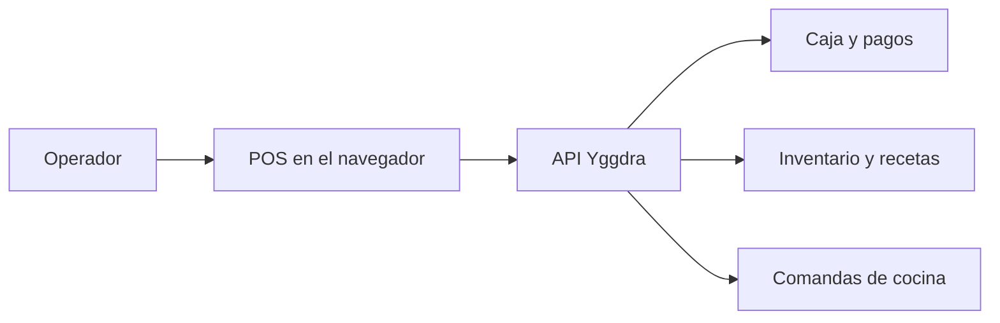

# Arquitectura — Frig

Cliente Next.js con export estático. La sesión, la sucursal y el catálogo viven en el navegador y se refrescan contra la API Ginnung.

## Estructura

```
src/app            rutas (App Router): operación, auth, checkout, menú público, políticas
src/components     POS, cocina (KDS), mesas, sucursales, landing, UI
src/lib            cliente HTTP, sesión, stores
src/content        textos de la landing
public/brand       marca
scripts            sync de contrato, post-export, auditoría de API
```

## Flujo de una venta



Cada llamada de negocio manda `Authorization: Token` y `X-Branch-ID`. La sucursal activa y el tema white-label se resuelven al entrar y se guardan en el cliente. Un mismo build sirve varias marcas: el dominio elige la sucursal en la API.

## Contrato

`scripts/sync-contract.mjs` escribe los tipos en `src/lib/api/types/` y el sha en `src/lib/api/contract-sha.ts`. El chequeo reutilizable de `yggdra_infra` todavía no está cableado en `.github/workflows` de este repo.

## Publicación

`dev` compila con `NEXT_PUBLIC_BASE_PATH=/frig` y sube el export a GitHub Pages. `production` compila sin ese prefijo y lo sube por FTP a los tres hostings, con `.htaccess` generado para las rutas del SPA.
